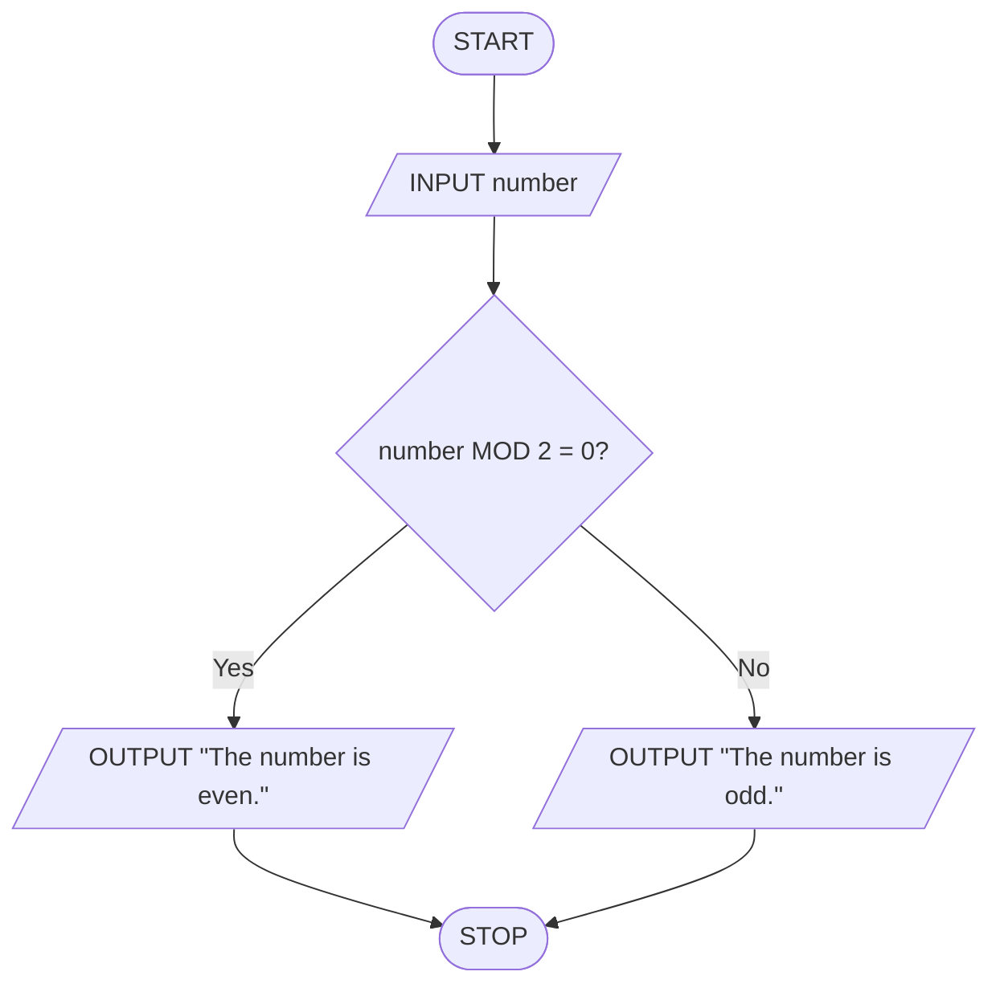

# Computational Thinking — Part A (Writing)

## Question (a): What is Computational Thinking?

Computational thinking is a systematic way of solving problems by applying ideas and methods used in computer science. It involves breaking a problem into smaller parts, identifying useful patterns, simplifying important information, and designing a clear sequence of steps to reach a solution. Computational thinking does not require the use of a computer; it is a method of reasoning that can be applied to many types of problems.

The purpose of computational thinking is to make problems easier to understand, solve, and explain. In computer science, it helps programmers analyse requirements, design algorithms, organise data, and create reliable software. It is also useful in everyday problem-solving because it encourages people to work logically, focus on relevant information, and develop solutions that can be repeated or improved. For example, planning the most efficient route to several destinations can involve breaking the journey into stages, recognising route patterns, ignoring unnecessary details, and arranging the steps in a suitable order.

## Question (b): Fundamental Concepts of Computational Thinking

### 1. Decomposition

Decomposition is the process of breaking a large or complex problem into smaller, more manageable parts. Each smaller part can be understood and solved separately, which reduces complexity and makes it easier to organise, test, and improve the complete solution.

**Example:** When organising a school event, the task can be divided into choosing a venue, preparing a guest list, arranging food, and managing invitations. Each part can be handled independently before combining them into the final event plan.

### 2. Pattern Recognition

Pattern recognition is the process of identifying similarities, repeated features, or regular trends in information or problems. Recognising patterns is important because a solution that works for one situation may be adapted for other situations with similar characteristics. This can save time and reduce unnecessary work.

**Example:** A student notices that every time a monthly budget is prepared, transport costs are higher during examination periods. This repeated trend can be used to plan a larger transport budget for future examination months.

### 3. Abstraction

Abstraction is the process of concentrating on the important features of a problem while ignoring details that are not needed for the current task. It simplifies problem-solving by creating a clear model of the problem without unnecessary information.

**Example:** A map of a city represents roads, locations, and directions but does not show every building, tree, or person. By leaving out these unnecessary details, the map makes it easier to plan a journey.

### 4. Algorithm Design

Algorithm design is the process of creating a precise, ordered set of instructions for solving a problem or completing a task. It is an important part of computational thinking because it turns an identified solution into steps that a person or computer can follow consistently.

**Example:** To make a cup of tea, an algorithm could instruct a person to boil water, place a tea bag in a cup, pour in the hot water, wait for the tea to brew, remove the tea bag, and add milk or sugar if required.

## Question (c): Algorithm to Determine Even or Odd Numbers

An even number is an integer that can be divided by 2 with no remainder. An odd number is an integer that leaves a remainder of 1 when divided by 2. The remainder can be checked using the modulo operation, written as `number MOD 2`.

### Step-by-Step Algorithm

1. **START**
2. **INPUT** an integer called `number`.
3. **IF** `number MOD 2 = 0`, **OUTPUT** “The number is even.”
4. **ELSE**, **OUTPUT** “The number is odd.”
5. **STOP**

### Example

Suppose the input is `7`.

1. Calculate `7 MOD 2`.
2. The remainder is `1`, not `0`.
3. The **IF** condition is false, so the **ELSE** branch is followed.
4. The output is: **“The number is odd.”**

### Mermaid Flowchart

